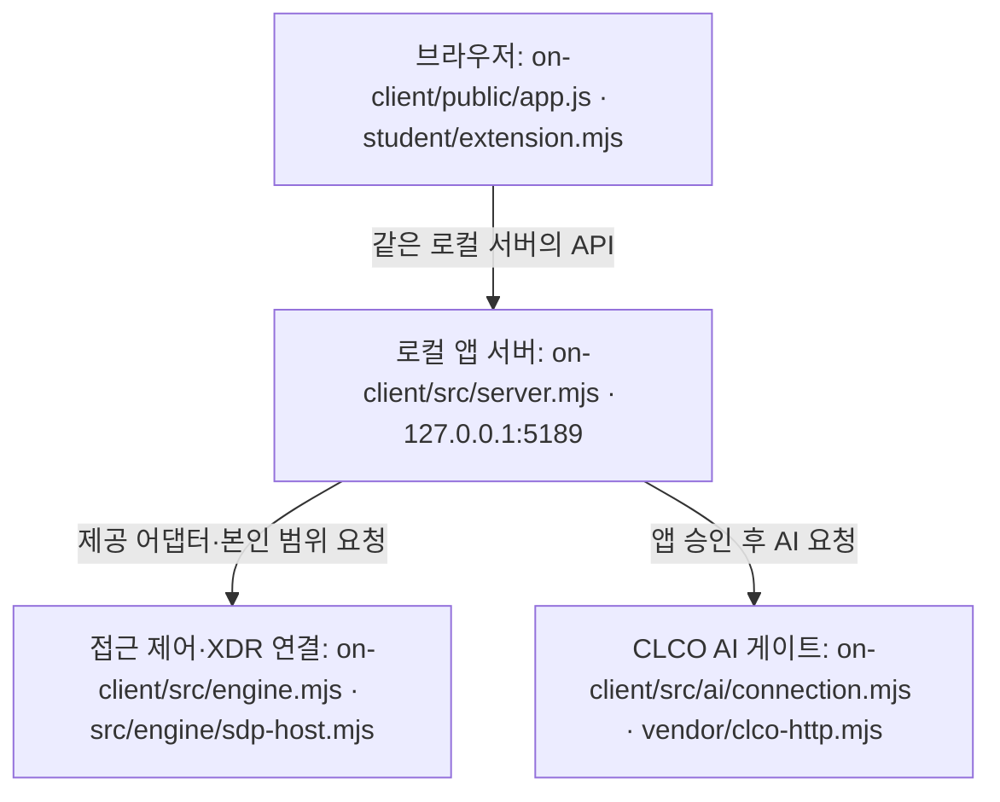

# nævis — 학생 실행 설명서와 시스템 구성도

이 문서는 4차 방어전 13~21단계의 학생 작업을 설명합니다. nævis는 본인의 계정·기기·세션, 업무 앱 판정, 최근 보안 기록과 AI·조치·패키지 조회 상태를 구분해 보여 주는 로컬 웹 앱입니다. 앱을 켰다는 사실은 실제 SDP·XDR·AI 연결이나 보안 조치 성공을 뜻하지 않습니다.

코드 대조 기준: `5f7e659aecccb04c275fca39b034c581674933bf`(20단계 구현). 21단계는 이 코드에 학생 문서만 추가합니다. 21단계 제출 커밋은 이 문서를 포함하는 실제 Git 커밋이며, 문서 안에 미리 만든 해시를 쓰지 않습니다. 확인 기록 기준일은 2026-10-26입니다.

## 1. 지원 환경과 확인한 버전

| 항목 | 현재 파일·기록에서 확인한 값 | 확인 범위 |
| --- | --- | --- |
| 시작 틀 | `on-client/package.json`: `alekov-client-starter` 0.2.11 | 파일 대조 |
| Node.js | package의 수업 기준 24.19.0. 제공 실행 도구는 주 버전 22~24를 허용 | 사용자 Windows의 21단계 현재 버전은 다시 확인 필요 |
| 문서 작성 환경 | Node.js v24.22.1, Git 2.51.1 | AI 작업 환경에서 명령 실행으로 확인. 사용자 PC 값과 구분 |
| 사용자 Git | 2.56.0.windows.2 | 이전 사용자 보고. 현재 값은 아래 명령으로 확인 |
| 운영체제·브라우저 | Windows PowerShell과 PC Chrome에서 사용자가 화면 확인 | 다른 운영체제의 전체 흐름·모바일·다른 브라우저는 미확인 |
| 외부 npm 의존성 | `on-client/package.json`에 dependencies/devDependencies 없음 | 앱 실행에 추가 패키지 설치가 필요하지 않음 |

필요 프로그램은 Node.js, Windows PowerShell, 저장소 동기화·원문 제출에 사용할 Git입니다. 워크벤치가 켜져 있어야 로컬 웹 앱이 실행되는 것은 아닙니다. 다른 Node.js 버전과 환경은 동작을 보장하지 않습니다.

## 2. 작업 폴더를 정확히 구분하기

이 사용자가 현재 실행·제출하는 Git 최상위 폴더는 `$env:USERPROFILE\Desktop\naevis-submit`입니다. 아래 명령은 그 폴더를 기준으로 합니다. 다른 PC에서는 실제 Git 최상위 경로로 바꿉니다. 파일 탐색기에서 해당 폴더를 열고 주소 표시줄에 `powershell`을 입력해 새 창을 열 수 있습니다.

| Git 최상위 기준 경로 | 역할·소유 범위 |
| --- | --- |
| `README.md` | 이전 1~12단계 기록과 학생 문서 진입 링크. 기존 기록 보존 |
| `on-client/package.json` | 4차 로컬 앱 버전·실행 스크립트 |
| `on-client/student/extension.mjs` | 학생이 구현한 8개 화면 함수 |
| `on-client/student/engine-adapter.mjs` | 제공된 본인 범위 SDP 연결 어댑터. 학생 화면 구현 중 변경하지 않음 |
| `on-client/public/index.html`, `public/app.js`, `public/style.css` | 제공 화면·이벤트 연결·상태 관리 |
| `on-client/src/server.mjs` | 제공 로컬 HTTP 서버와 API 처리 |
| `on-client/src/engine.mjs`, `src/engine/` | 제공 미연결·예제·SDP 연결 계층 |
| `on-client/src/ai/`, `src/connection/`, `vendor/clco-http.mjs` | 제공 계정 연결·AI 승인·중계 계층 |
| `on-client/src/actions/` | 제공 조치 준비·전달·결과 조회 계층. 현재 실제 학생 집행은 미확인 |
| `on-client/src/vulnerabilities/`, `public/vulnerabilities-view.mjs` | 제공 설치 메타데이터 검사·OSV 조회·결과 형식 검사 |
| `on-client/tools/start-alekov.ps1` | 제공 Windows 실행 도구 |
| `on-client/docs/STUDENT_RUNBOOK.md` | 이 학생 설명서 |

표에서 첫 경로 뒤의 축약된 `src/`, `public/`, `vendor/`도 모두 `on-client/` 안의 경로입니다. 과거 실행하던 워크벤치 아래 독립 `on-client` 사본과 바탕화면의 Git 저장소 사본을 혼용하지 않습니다. `on-client` 안에서 별도의 Git 저장소를 만들지 않습니다. 기존 파일을 새 시작 틀로 덮어쓰지 않습니다.

## 3. 설치 확인·실행·정상 시작 신호

### 3-1. 새 PowerShell 창에서 위치와 버전 확인

```powershell
Set-Location "$env:USERPROFILE\Desktop\naevis-submit"
git rev-parse --show-toplevel
git status --short
node --version
git --version
```

출력된 Git 최상위가 실행하려는 저장소와 같은지 확인합니다. 변경 파일이 있으면 내용을 먼저 확인하고 보존합니다. `git pull --ff-only`는 앞 단계에서 실제 사용했지만, 변경·충돌이 있는 경우 무작정 반복하거나 초기화하지 않습니다.

GitHub에 반영된 학생 코드를 받아야 할 때만 같은 Git 최상위에서 실행합니다.

```powershell
git pull --ff-only
```

현재 `on-client`에는 추적된 `package-lock.json`이 없고 외부 npm 의존성도 없습니다. 현재 앱을 켜기 위해 `npm install`이나 `npm ci`를 추가 실행할 필요가 없습니다. Git 최상위의 이전 자료실용 package/lock과 이 앱을 혼동하지 않습니다. 취약점을 만들려고 의존성을 추가하거나 낮추지 않습니다.

### 3-2. 앱 폴더에서 실행

```powershell
Set-Location "$env:USERPROFILE\Desktop\naevis-submit\on-client"
node src/server.mjs
```

이 명령은 사용자가 기존 단계에서 실행해 화면을 연 방법입니다. PowerShell 창을 닫지 않습니다. 기본 포트에서는 다음 시작 줄이 나오는지 봅니다.

```text
케셰브 연결 확인: http://127.0.0.1:5189
```

이 문구는 `src/server.mjs`의 시작 로그이며 **원격 연결 성공 표시가 아닙니다**. 학생이 정한 이름은 nævis이지만 제공 시작 로그는 케셰브로 남아 있습니다. 브라우저에서 [http://127.0.0.1:5189/](http://127.0.0.1:5189/)를 열어 보호 현황·업무 앱·보안 기록 메뉴와 학생 구현 영역을 확인합니다. 기본 설정에서는 연결 없음이 정상이며, 화면이 열린 사실만으로 인증·AI 연결을 확인했다고 적지 않습니다.

`npm start`도 package에 정의된 같은 명령입니다. 사용자 PC에서 이 별칭을 다시 실행한 결과는 이 단계에서 미확인입니다. 제공 실행 도구를 쓰려면 [STUDENT_LAUNCH_GUIDE.md](STUDENT_LAUNCH_GUIDE.md)를 따릅니다. 도구 자체는 파일을 읽어 확인했으며 21단계 Windows 실행 실측은 아직 미확인입니다.

### 3-3. 예제 표시와 문법 검사

실행 중인 **본인 서버**를 그 창에서 Ctrl+C로 종료한 뒤 같은 앱 폴더에서 실행합니다.

```powershell
node src/server.mjs --demo
```

시작 로그는 `케셰브 예제: http://127.0.0.1:5189`입니다. 예제 자료(demo)는 앞 단계에서 사용자 화면 확인을 했습니다. 연습 사용자·연습 PC·practice-session과 예제 판정·event-01은 실제 직원·운영 탐지 결과가 아닙니다. 기본 실행으로 돌아갈 때는 Ctrl+C 후 `node src/server.mjs`를 실행합니다. 두 서버를 같은 포트에서 동시에 켜지 않습니다.

앱 폴더의 별도 PowerShell에서 문법만 검사할 수 있습니다.

```powershell
npm run check
```

이 검사는 AI 작업 환경에서 실행해 통과했으며 사용자 PC에서의 21단계 재실행은 미확인입니다. 문법 통과는 실제 연결·공식 과제 통과·보안 효과 확인이 아닙니다.

### 3-4. 종료·재실행·새로고침

1. 서버를 실행한 PowerShell에서 Ctrl+C를 누릅니다. 다른 프로그램을 강제 종료하지 않습니다.
2. 같은 `on-client` 위치에서 `node src/server.mjs`로 다시 켭니다.
3. 브라우저 주소를 다시 열고, 학생 파일을 갱신했다면 Ctrl+Shift+R로 새로고침합니다. 화면의 다시 불러오기는 서버를 켜는 버튼이 아닙니다.

서버가 꺼진 동안에는 사이트에 연결할 수 없음 또는 조회 실패가 나올 수 있습니다. 2026-10-26 사용자가 새 PowerShell에서 이 설명서의 `node src/server.mjs`를 실행해 시작 로그와 세 메뉴·학생 구현 영역을 확인했습니다. 이어 Ctrl+C로 종료하고 같은 명령으로 재실행한 뒤 새로고침해 같은 화면이 다시 보인다고 보고했습니다. **21단계 기본 실행·종료·재실행은 사용자 확인 완료**이며, AI의 직접 Windows 실행이나 원격 연결 실측을 뜻하지 않습니다. 재시작이 포털 승인·기기 권한 복구를 뜻하지 않습니다.

## 4. 글로 읽는 시스템 구성도



| 구간 | 실제 파일·공개 주소 | 데이터 흐름·현재 확인 범위 |
| --- | --- | --- |
| 브라우저 ↔ 로컬 서버 | `on-client/public/app.js`, `on-client/src/server.mjs`, `http://127.0.0.1:5189/` | 제공 코드가 조회·판정·취소를 처리하고 학생 함수에 상태와 결과를 전달. 예제·미연결 화면은 사용자 확인 |
| 로컬 서버 ↔ 접근 제어·XDR 시스템 | `on-client/student/engine-adapter.mjs`, `on-client/src/engine/sdp-host.mjs` | 제공 ALEPH SDP 엔진 연결 경계. 실제 연결 주소·자격은 운영자가 준비하며 이 문서에 기재하지 않음. 운영 연결·XDR 전달은 기다림(UNV) |
| 로컬 서버 ↔ AI 게이트 | `on-client/src/ai/connection.mjs`, `on-client/src/ai/service.mjs`, `on-client/vendor/clco-http.mjs` | 제공 CLCO 수업용 AI 게이트를 통한 모델 점검·사건 설명. 코드의 공개 기본 origin은 `https://ai-classroom-gateway-production.up.railway.app`. 실제 호출은 미확인 |
| 로컬 서버 ↔ OSV | `on-client/src/vulnerabilities/project-scan.mjs`, `osv.mjs` | 담당자가 승인한 공개 패키지의 정확한 설치 버전만 `https://api.osv.dev/v1/querybatch`에 조회. 현재 PROJECT_NOT_CONFIGURED로 외부 조회 미확인 |

구성도에서 외부 시스템 상자에 적은 파일은 **학생 PC의 연결 모듈 위치**이며 원격 서버를 학생이 만들었다는 뜻이 아닙니다. 구성도와 주소는 소스로 대조했으며 외부 주소가 실제 응답하는지는 이번 단계에서 시험하지 않았습니다.

Workbench/GPT는 개발을 돕는 AI, 앱 내부 AI는 사건 설명용 AI, ALEPH 공식 판정 AI는 제출 원문을 검토하는 AI입니다. 역할과 결과를 서로 대신 쓰지 않습니다. 브라우저는 AI 회사에 직접 요청하지 않으며, 학생 함수는 받은 값을 표시합니다. 진단 정보도 제공 화면이 조회해 전달합니다.

## 5. 제공 코드와 학생 함수 경계

아래 목록은 이번 작업에서 실제 파일과 대조한 경계입니다. 제공 영역 manifest가 새로 배포되면 그 목록도 함께 대조해야 하며 이 표로 제공 권한을 확대하지 않습니다.

| 학생 함수 (`on-client/student/extension.mjs`) | 입력·표시하는 내용 | 제공 코드에 남겨 둔 일 |
| --- | --- | --- |
| `createStudentView` | 제공 화면이 사용할 8개 렌더링 함수를 반환 | 모듈 로딩·학생 영역 DOM 교체 |
| `renderIdentity` | me·devices·sessions의 상태, 사용자·기기·세션 ID와 상태. 오류 시 이전 값 제거 | 신원·기기·세션 검증 및 조회 |
| `renderDecision` | status·mode·appId·data·error. allow·deny·challenge·unknown, 이유·시각·요청 실패 구분 | 선택 앱 접근 판정 요청과 취소 |
| `renderEvents` | 기록 배열의 최신순 정렬, 세 필터, 상세 근거·규칙·세 상태. 미지원 조치는 비활성 안내만 | 본인 최근 최대 40건 조회·검증. 운영 XDR 탐지는 별도 시스템 |
| `renderStatus` | devices·sessions·notifications·diagnostics·mode. 빈 목록·실패 구분, 안전한 진단 6항목의 수동 복사 | `/api/diagnostics` 조회. 학생 코드에서 직접 호출하지 않음 |
| `renderAiConnection` | 점검 status·mode·data·error·checkedAt 등. test·verified와 모델 수, 점검과 설명 구분 | 계정 연결·AI 앱 승인·모델 요청·세대 검사 |
| `renderExplanation` | event·explanation·checkedAt. 참고용 요약을 현재 근거 ID·규칙·unknown 상태에 연결하고 미실행 제안 표시 | 사건 선택·요청·응답 검증·다른 사건 선택 시 늦은 응답 차단 |
| `renderAction` | 상태·사건·조치·대상·receipt·observation 등. ACK와 효과 관측 구분 | 확인 티켓·집행·재조회·중복 방지. 학생 함수에 버튼·POST·티켓 없음 |
| `renderVulnerabilities` | 상태·mode·data·error. 정확한 버전·출처·시각·취약점 ID, 미조회·일부 실패 구분 | lock/node_modules 대조·공개 허용 목록·OSV 요청·취소·늦은 응답 차단 |

앞 단계까지 학생 화면은 `createElement`와 `textContent`로 작성했습니다. 계정·토큰·조치 권한을 학생 화면이 새로 만들지 않습니다. 현재 실제 기록의 supportedActions는 빈 배열이므로 조치 준비 버튼이 없는 것이 정상입니다. `succeeded`와 `observation.effectApplied === true`가 함께 와야 학생 화면은 효과 확인으로 표시합니다. 현재 실제 집행 연결·효과는 미확인입니다.

## 6. 설정·lock·문서의 차이와 비밀 관리

- 실제 스크립트는 `start`, `demo`, `check`입니다. 제공 AI 안내에 남아 있는 `test` 표기를 따라 존재하지 않는 `npm test`를 실행하지 않습니다. 이 단계에서 제공 문서를 덮어쓰지 않았습니다.
- 제공 README는 `.env.example`을 언급하지만 현재 추적 파일에는 없습니다. 이 앱을 기본 실행하기 위해 새 .env나 인증 설정을 만들지 않습니다. 비밀을 Git·문서·원문 JSON에 넣지 않습니다.
- `on-client`에는 추적된 package-lock이 없습니다. 20단계의 조회 대상은 운영자가 설정한 프로젝트이며 Git 최상위의 과거 자료실 package-lock을 임의로 연결하지 않습니다. 현재 `PROJECT_NOT_CONFIGURED` 결과를 우회하지 않습니다.
- 제공 실행 도구는 `-NativeHostConfig`와 `-SdpHostConfig`를 구분합니다. 두 설정은 서로 대체할 수 없으며 운영자가 발급한 프로젝트 밖의 파일만 사용합니다. 사용자는 native 설정을 받지 않았다고 보고했습니다. 실제 발급 경로가 없으므로 이 설명서에는 가상의 연결 명령을 만들지 않습니다.
- `ON_PROJECT_DIRECTORY`와 `ON_APPROVED_PUBLIC_PACKAGES`는 서버 코드에 있는 운영 설정 이름입니다. 학생이 값을 임의로 채우거나 공개·비공개 패키지 이름을 외부에 보내지 않습니다.
- 제공 라이브러리의 출처는 [vendor/NOTICE.md](../vendor/NOTICE.md)에 있습니다. 제공 코드를 학생 저작 또는 공개 라이선스라고 새로 선언하지 않습니다.

## 7. 장애별 확인·복구 순서

| 화면·오류 | 확인 순서 | 복구·다시 시도 |
| --- | --- | --- |
| node 또는 npm을 인식하지 못함 | 새 PowerShell에서 `node --version`, 설치·PATH 확인 | 필요한 Node를 준비한 뒤 새 창. 작업 폴더 존재만으로 실행 프로그램이 설치되지는 않음 |
| git을 인식하지 못함 | `git --version` | Git 설치·PATH 확인 후 새 창. 기존 폴더 보존 |
| not a git repository | `git rev-parse --show-toplevel`, 현재 위치 확인 | 기존 Git 최상위로 이동. 별도 사본에 무작정 git init하지 않음 |
| 사이트에 연결할 수 없음 | 서버 창이 살아 있는지, 실행 위치·브라우저 포트 확인 | 본인 서버의 실제 오류를 확인하고 위 실행 절차로 켜기. 세션 만료로 단정하지 않음 |
| EADDRINUSE / 포트 사용 중 | 이미 본인 서버를 켜 두었는지 확인 | 기존 서버를 사용하거나 본인 서버만 Ctrl+C. 다른 프로세스 강제 종료 금지. 다른 포트 실행은 제공 도구 안내 참조·학생 실측은 미확인 |
| 연결 없음(disconnected), ENGINE_NOT_CONNECTED | 기본 실행인지·SDP 설정 발급 여부 확인 | 정상 데이터로 채우지 않음. 운영자가 설정을 준비한 뒤 제공 절차로 연결 |
| NATIVE_HOST_DISABLED | 이 PC에 계정 연결 기능 설정이 발급됐는지 | 설정을 받기 전 연결 성공으로 표시하지 않음. 키를 복사하거나 registry/Vault를 직접 만들지 않음 |
| ON_AI_PROVISIONING_PENDING 등 권한 준비 중 | 계정 연결·앱 승인·운영 앱 권한 준비 확인 | 담당자에게 안전한 도움정보로 문의. 학생 화면 수정만으로 권한을 발급할 수 없음 |
| AI 점검 실패·시간 초과·취소 | 안전한 code·message, 현재 선택·시각 확인 | 사용자가 직접 재점검. 모델 목록 확인을 사건 설명 성공으로 계산하지 않음 |
| AI 설명 실패·근거 불일치 | 선택 사건의 ID·근거·규칙과 오류 안내 확인 | 기록은 보존. 근거를 지어내거나 유료 요청을 반복하지 않음 |
| CONTRACT_MISMATCH / 확인 불가 | 안전한 오류 코드·제공 데이터 계약 확인 | 다시 불러오기 한 번, 반복되면 담당자 문의. 빈 정상 결과로 바꾸지 않음 |
| 조치 unknown·미실행·UNV | ACK와 효과 관측을 구분, 현재 대상·requestId·receiptId 확인 | 시험 집행 금지. unknown은 효과 없음이 아니며 제공 화면에서 결과만 재조회. 취소는 이미 발생한 효과를 되돌리지 않음 |
| PROJECT_NOT_CONFIGURED / not_configured | 조회 시각이 있는 설정 미완료 응답인지 확인 | 담당자가 조회 대상·공개 허용 목록 준비. 학생 임의 설정 변경 금지 |
| not_checked / unverifiable / partial | 미조회·lock 확인 불가·일부 실패를 각각 확인 | 받은 취약점 ID는 보존. none_found나 앱 안전으로 바꾸지 않음 |
| 조회 실패 뒤 옛 목록이 없어짐 | 실패 안내와 현재 상태 확인 | 정상적인 이전 결과 제거. 서버 복구 후 제공 버튼으로 직접 다시 조회 |

사용자가 보고한 구체적 장애는 NATIVE_HOST_DISABLED, 서버 종료 중 조회 실패, PROJECT_NOT_CONFIGURED입니다. 표의 나머지는 코드에서 확인한 분기이며 모두 실제 장애를 재현했다는 뜻은 아닙니다. 자세한 제공 안내는 [CONNECTION_TROUBLESHOOT.md](CONNECTION_TROUBLESHOOT.md)를 봅니다.

## 8. 확인 결과와 기다림(UNV)

| 구분 | 확인한 것 | 증거 성격·한계 |
| --- | --- | --- |
| 사용자 실제 화면 | 21단계 설명서의 기본 실행·종료·재실행 후 세 메뉴·학생 구현 영역 표시 | 2026-10-26 사용자 보고. 코드 기준 c1feb97a9cde1f4983e6327527be98858e5fa066. 다른 PC·새 폴더 재현과 원격 연결은 미확인 |
| 사용자 실제 화면 | 세 메뉴 마우스·키보드 이동, 예제 계정·기기·세션 표시 | 사용자 보고. 실제 SDP 연결 인증 아님 |
| 사용자 실제 화면 | 예제 앱 allow·deny·challenge와 이유·시각, 요청 실패 구분 | 운영 정책을 바꿔 모든 결과를 재현한 것 아님 |
| 사용자 실제 화면 | event-01 상세의 근거·규칙·각 상태, 다시 불러오기 후 상세 제거, 실패 후 회복 | 예제 access 기록 한 건. 운영 XDR 목록·여러 앱 필터는 미확인 |
| 사용자 실제 화면 | 안전한 진단 6항목 복사, 비밀 없음, 오류 후 정상 표시, 자동 요청 증가 없음 | 사용자가 직접 읽고 보고. 진단 값 원문은 이 문서에 저장하지 않음 |
| 사용자 실제 화면 | AI·설명 초기 상태, NATIVE_HOST_DISABLED | 실제 AI 호출 성공 아님 |
| 사용자 실제 화면 | 19단계 idle과 다시 불러오기 후 미실행 유지 | 실제 조치·대상 변경을 시험하지 않음 |
| 사용자 실제 화면 | 20단계 not_configured, 제공·학생 화면의 checkedAt 일치, 직접 재조회 후 새 시각 | 2026-10-26T02:43:12.940Z → 02:44:44.002Z. 실제 OSV 조회 아님 |
| 코드·모의 입력 | 앞 단계 상태별 표시, 근거 결속·실패·unknown, 조치 ACK/효과, 부분 취약점 ID 유지, 새 DOM 교체 | AI 작업 환경의 모의 DOM·응답 점검. 운영 효과 증거 아님 |
| 코드·모의 입력 | 제공 함수의 취소·새 요청 후 늦은 응답 무시와 오류 뒤 수동 회복 | 모의 응답을 사용. 실제 외부 AI·OSV 요청 없음 |
| 문법 | `npm run check` | AI 작업 환경에서 통과. Windows 새 창 재현은 미확인 |

**기다림(UNV)**: 실제 SDP 사용자·기기·세션·XDR 조회, 계정/native·AI 앱 권한 연결, 실제 모델/사건 설명 호출, 실제 학생의 조치 집행·효과 재조회·중복 집행 방지 실측, 조회 대상 설정 후 정확한 설치 버전 대조·실제 OSV 조회, 실제 화면에서 패키지 조회 중 취소, 다른 PC/새 폴더의 22단계 재현. 모의 입력 통과와 원문 AI 판정은 이 목록의 실측 완료를 대신하지 않습니다.

## 9. 21단계 직접 확인·제출 순서

1. 기존 작업은 그대로 두고, 새 PowerShell에서 3장의 위치·버전 확인 후 앱을 실행합니다. 이미 서버가 켜져 있으면 기존 창을 먼저 확인하여 중복 실행하지 않습니다.
2. 보호 현황에서 학생 계정 영역과 패키지 조회 상태를 확인합니다. 실제 값·예제·미연결·미조회 중 무엇인지 기록합니다. 화면 버튼 이름·실제 경로가 문서와 다른 경우 그대로 알려 주고 미확인으로 남깁니다.
3. 서버를 Ctrl+C로 종료하고 같은 명령으로 다시 켜지는지 확인합니다. 외부 AI·집행·인증·OSV 연결은 확인을 위해 임의 실행하지 않습니다.
4. 문서와 이번 단계 변경이 같은 실제 커밋에 있는지 확인합니다. 이 단계는 UI·서버 코드를 변경하지 않았으므로 기존 학생 코드가 그 커밋에 그대로 포함됩니다.
5. 21·22단계는 현재 워크벤치의 포털 제출 준비 대신 과제 화면에 저장소 주소와 40자리 커밋을 직접 입력합니다. 원문 전달 도구는 과제 화면에서 받고 Git 최상위에서 실행합니다. 도구·JSON 출력은 프로젝트 밖에 둡니다. 실제 경로·커밋을 확인한 뒤 명령을 안내받습니다.
6. 같은 단계의 원문 JSON을 선택하고 저장소·커밋·단계를 확인하여 본인이 제출합니다. 원문 전달 성공과 공식 검토 통과는 다릅니다. 원문 전달만 실패하면 기존 접수의 원문만 다시 보내기를 사용합니다.

실제 유료 AI 요청·보안 조치·공식 단계 제출은 이 문서 작성 중 실행하지 않았습니다. 실행하지 않은 검사는 미확인으로 남깁니다.
